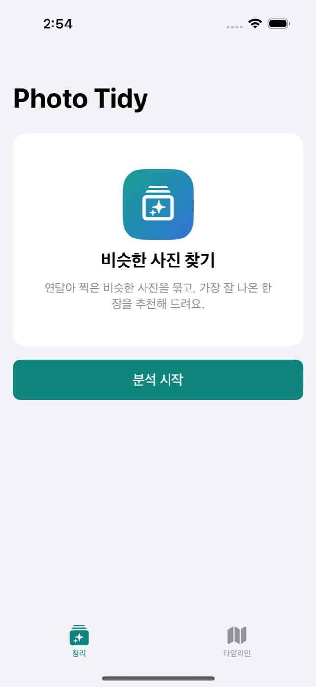
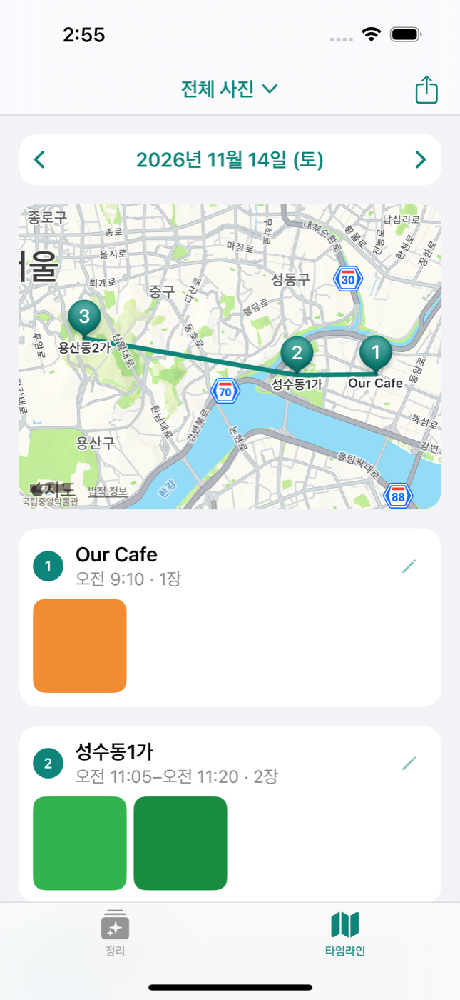

# Photo Tidy

아이폰 사진첩을 정리하고 돌아보는 개인용 앱입니다.

- **정리** — 연달아 찍은 비슷한 사진을 묶고, 잘 나온 한 장을 추천합니다. 남길 사진을 확인하면 나머지를 지웁니다.
- **타임라인** — 사진의 위치와 시각으로 "머문 곳"을 만들어 지도와 목록으로 보여 줍니다.

사진은 기기 밖으로 나가지 않습니다. 타임라인의 장소 이름을 받을 때만 머문 곳의 좌표가 애플 지도 서버로 전송됩니다.

## 기능

### 정리

| 홈 | 분석 결과 | 묶음 상세 |
| --- | --- | --- |
|  |  |  |

- 촬영 간격이 1분 이내인 사진끼리 비교해 비슷한 것을 묶습니다.
- 선명도, 얼굴 상태, 즐겨찾기·편집 여부로 한 장을 추천합니다.
- 삭제 전에 아이폰이 확인 창을 띄우고, 지운 사진은 "최근 삭제된 항목"에 남습니다.
- 다음 분석부터는 새로 찍은 사진만 봅니다.

### 타임라인

| 하루씩 보기 | 앨범 전체 보기 | 공유되는 이미지 |
| --- | --- | --- |
|  |  |  |

- **하루씩 보기**: 200m 안에서 이어 찍은 사진을 한 곳으로 묶어 번호 핀과 경로로 보여 줍니다.
- **앨범 전체 보기**: 앨범(사진 앱의 공유 앨범 포함) 하나를 골라 여러 날을 한 화면에 이어 봅니다.
- **장소 이름**: 동네 이름을 자동으로 붙이고, 연필 버튼으로 직접 고칠 수 있습니다.
- **이미지 공유**: 보고 있는 타임라인을 이미지 한 장으로 만들어 공유합니다.

화면 전체 캡처는 [`docs/screenshots/`](docs/screenshots)에 있습니다.

## 시작하기

필요한 것: Xcode 26 이상, XcodeGen(`brew install xcodegen`)

```bash
xcodegen generate          # PhotoTidy.xcodeproj 생성
open PhotoTidy.xcodeproj
```

Xcode 상단에서 실행 대상(시뮬레이터 또는 연결한 아이폰)을 고르고 ▶ 를 누릅니다.
파일을 추가·삭제하거나 `project.yml`을 고치면 `xcodegen generate`를 다시 실행합니다.

### 내 아이폰에 설치

1. Xcode > Settings > Accounts에 Apple 계정을 추가합니다.
2. 프로젝트 > PhotoTidy 타깃 > Signing & Capabilities에서 Team을 고릅니다.
3. 아이폰을 연결하고 실행합니다. 처음에는 아이폰 설정 > 일반 > VPN 및 기기 관리에서 개발자를 신뢰해야 합니다.

무료 Apple 계정으로 설치한 앱은 7일 뒤 만료되어 다시 설치해야 합니다(앱 데이터는 남습니다).

`xcodegen generate`를 다시 돌리면 2번의 Team 선택이 지워집니다. `project.yml`의 PhotoTidy `settings.base`에 `DEVELOPMENT_TEAM: <팀 ID>`를 적어 두면 유지됩니다.

## 테스트

### 로직 테스트

맥에서 바로 실행됩니다.

```bash
swift test --package-path PhotoTidyCore
```

### 시뮬레이터 화면 테스트

권한 허용부터 분석·삭제, 타임라인, 앨범, 이름 고치기·공유까지 자동으로 조작합니다.
**시뮬레이터 사진첩에서 실제로 사진 1장을 삭제합니다.**

```bash
xcrun simctl list devices available | grep iPhone       # 기기 ID 확인
SIM=<기기 ID>
xcrun simctl boot $SIM

# 샘플 사진 넣기
xcrun simctl addmedia $SIM a.jpg a-copy.jpg                          # 같은 사진 2장 (정리 테스트용)
swift scripts/make-timeline-samples.swift build/timeline-samples     # 위치·시각이 든 사진 4장
xcrun simctl addmedia $SIM build/timeline-samples/*.jpg

# 권한·분석 결과 초기화 후 실행
xcrun simctl uninstall $SIM com.heejung.phototidy
xcodebuild test -project PhotoTidy.xcodeproj -scheme PhotoTidy \
  -destination "platform=iOS Simulator,id=$SIM" -derivedDataPath build
```

정리 테스트는 사진을 지우므로, 다시 돌릴 때마다 같은 사진 2장을 다시 넣어야 합니다.
시뮬레이터에는 공유 앨범이 없어서, 앨범 테스트는 사진첩 전체를 담은 "샘플 앨범"을 만들어 확인합니다.

## 조정할 수 있는 값

[`PhotoTidyCore/Sources/PhotoTidyCore/Tuning.swift`](PhotoTidyCore/Sources/PhotoTidyCore/Tuning.swift)

| 값 | 기본 | 뜻 |
| --- | --- | --- |
| `maxGap` | 60초 | 연달아 찍은 사진으로 보는 시간 간격 |
| `distanceThreshold` | 0.5 | 비슷하다고 보는 정도. 다른 사진이 같이 묶이면 낮추고, 비슷한 사진이 안 묶이면 높입니다 |
| `stopRadius` | 200m | 타임라인에서 같은 곳에 머문 것으로 보는 반경 |

## 구조

| 폴더 | 내용 |
| --- | --- |
| `PhotoTidyCore/` | 묶기·추천·저장·타임라인 로직. 화면과 사진첩에 의존하지 않습니다 |
| `PhotoTidy/` | 사진첩·지도 접근, 화면 |
| `PhotoTidyUITests/` | 시뮬레이터 화면 테스트 |
| `scripts/` | 테스트용 샘플 사진 생성 |
| `docs/superpowers/specs/` | 기능별 설계 문서 |
| `llm-wiki/` | 구조, 규칙, 결정, 알려진 문제를 정리한 위키 ([목차](llm-wiki/index.md)) |
| `dev-notes/` | 이 프로젝트를 이해하는 데 필요한 개발 지식 노트 ([목차](dev-notes/README.md)) |

## 알려진 한계

- 동영상은 다루지 않습니다.
- 공유 앨범 읽기는 실제 아이폰에서 아직 확인하지 못했습니다. 공유 앨범 사진에 위치 정보가 없으면 지도 없이 시간순 목록만 나옵니다.
- 분석한 뒤에 받은 옛날 사진(에어드롭, 메신저 저장 등)은 다시 분석되지 않습니다.
- 그 밖의 문제는 [`llm-wiki/known-issues.md`](llm-wiki/known-issues.md)에 있습니다.
