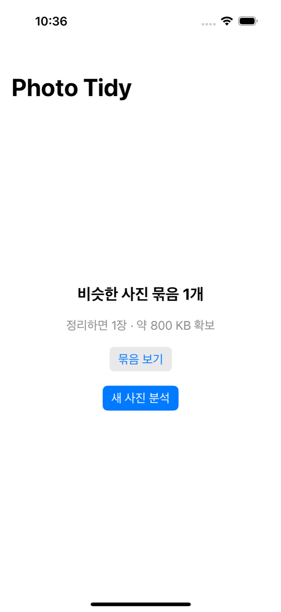
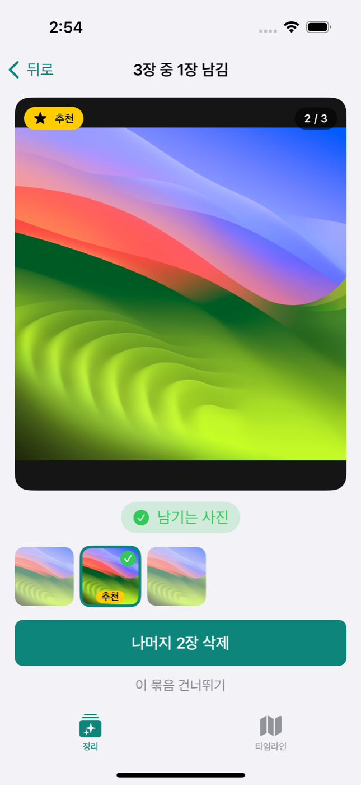
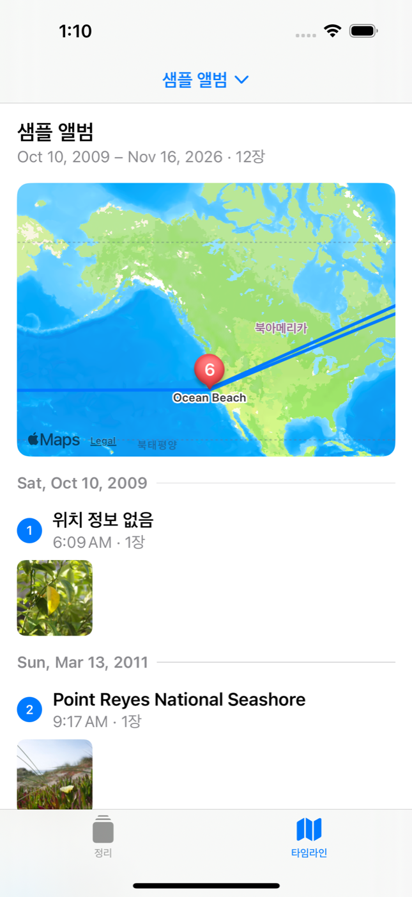
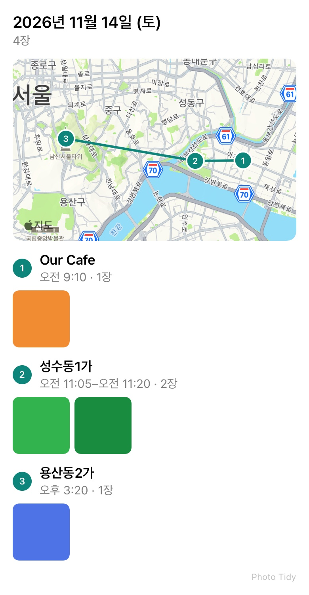

# Photo Tidy

아이폰 사진첩을 정리하고 돌아보는 개인용 앱입니다.

- **정리** — 연달아 찍은 비슷한 사진을 묶고, 잘 나온 한 장을 추천합니다. 남길 사진을 확인하면 나머지를 지웁니다.
- **타임라인** — 사진의 위치와 시각으로 "머문 곳"을 만들어 지도와 목록으로 보여 줍니다.

사진은 기기 밖으로 나가지 않습니다. 타임라인의 장소 이름을 받을 때만 머문 곳의 좌표가 애플 지도 서버로 전송됩니다.

## 기능

### 정리

| 홈 | 분석 결과 | 묶음 상세 |
| --- | --- | --- |
|  |  |  |

- 촬영 간격이 1분 이내인 사진끼리 비교해 비슷한 것을 묶습니다.
- 선명도, 얼굴 상태, 즐겨찾기·편집 여부로 한 장을 추천합니다.
- 삭제 전에 아이폰이 확인 창을 띄우고, 지운 사진은 "최근 삭제된 항목"에 남습니다.
- 다음 분석부터는 아직 분석하지 않은 사진만 봅니다. 나중에 받은 옛날 사진도 포함됩니다.

### 타임라인

| 하루씩 보기 | 앨범 전체 보기 | 공유되는 이미지 |
| --- | --- | --- |
|  |  |  |

- **하루씩 보기**: 200m 안에서 이어 찍은 사진을 한 곳으로 묶어 번호 핀과 경로로 보여 줍니다.
- **앨범 전체 보기**: 앨범(사진 앱의 공유 앨범 포함) 하나를 골라 여러 날을 한 화면에 이어 봅니다.
- **장소 이름**: 동네 이름을 자동으로 붙이고, 연필 버튼으로 직접 고칠 수 있습니다.
- **이미지 공유**: 보고 있는 타임라인을 이미지 한 장으로 만들어 공유합니다.

화면 전체 캡처는 [`docs/screenshots/`](docs/screenshots)에 있습니다.

## 시작하기

필요한 것: Xcode 26 이상, XcodeGen(`brew install xcodegen`)

```bash
xcodegen generate          # PhotoTidy.xcodeproj 생성
open PhotoTidy.xcodeproj
```

Xcode 상단에서 실행 대상(시뮬레이터 또는 연결한 아이폰)을 고르고 ▶ 를 누릅니다.
파일을 추가·삭제하거나 `project.yml`을 고치면 `xcodegen generate`를 다시 실행합니다.

### 내 아이폰에 설치

1. Xcode > Settings > Accounts에 Apple 계정을 추가합니다.
2. 프로젝트 > PhotoTidy 타깃 > Signing & Capabilities에서 Team을 고릅니다.
3. 아이폰을 연결하고 실행합니다. 처음에는 아이폰 설정 > 일반 > VPN 및 기기 관리에서 개발자를 신뢰해야 합니다.

무료 Apple 계정으로 설치한 앱은 7일 뒤 만료되어 다시 설치해야 합니다(앱 데이터는 남습니다).

`xcodegen generate`를 다시 돌리면 2번의 Team 선택이 지워집니다. `project.yml`의 PhotoTidy `settings.base`에 `DEVELOPMENT_TEAM: <팀 ID>`를 적어 두면 유지됩니다.

## 테스트

### 로직 테스트

맥에서 바로 실행됩니다.

```bash
swift test --package-path PhotoTidyCore
```

### 시뮬레이터 화면 테스트

권한 허용부터 분석·삭제, 타임라인, 앨범, 이름 고치기·공유까지 자동으로 조작합니다.
**시뮬레이터 사진첩에서 실제로 사진 1장을 삭제합니다.**

```bash
xcrun simctl list devices available | grep iPhone       # 기기 ID 확인
SIM=<기기 ID>
xcrun simctl boot $SIM

# 샘플 사진 넣기
xcrun simctl addmedia $SIM a.jpg a-copy.jpg                          # 같은 사진 2장 (정리 테스트용)
swift scripts/make-timeline-samples.swift build/timeline-samples     # 위치·시각이 든 사진 6장(이틀 치, 처음 한 번만)
xcrun simctl addmedia $SIM build/timeline-samples/*.jpg

# 권한·분석 결과 초기화 후 실행
xcrun simctl uninstall $SIM com.heejung.phototidy
xcodebuild test -project PhotoTidy.xcodeproj -scheme PhotoTidy \
  -destination "platform=iOS Simulator,id=$SIM" -derivedDataPath build
```

정리 테스트는 사진을 지우므로, 다시 돌릴 때마다 같은 사진 2장을 다시 넣어야 합니다. 이 2장은 "앨범이 실행 중에 바뀌는" 테스트에서 샘플 앨범에 새로 더해지는 사진으로도 쓰입니다.
시뮬레이터에는 공유 앨범이 없어서, 앨범 테스트는 사진첩 전체를 담은 "샘플 앨범"을 만들어 확인합니다.

## 조정할 수 있는 값

[`PhotoTidyCore/Sources/PhotoTidyCore/Tuning.swift`](PhotoTidyCore/Sources/PhotoTidyCore/Tuning.swift)

| 값 | 기본 | 뜻 |
| --- | --- | --- |
| `maxGap` | 60초 | 연달아 찍은 사진으로 보는 시간 간격 |
| `distanceThreshold` | 0.5 | 비슷하다고 보는 정도. 다른 사진이 같이 묶이면 낮추고, 비슷한 사진이 안 묶이면 높입니다 |
| `stopRadius` | 200m | 타임라인에서 같은 곳에 머문 것으로 보는 반경 |

## 폴더 구조

```
photo-tidy/
├── PhotoTidyCore/                 로직 패키지 — 화면·사진첩 없이 돌아가는 판단 규칙
│   ├── Package.swift
│   ├── Sources/PhotoTidyCore/
│   └── Tests/PhotoTidyCoreTests/  로직 테스트
├── PhotoTidy/                     앱 — 사진첩·지도 접근과 화면
│   └── Views/                     화면
├── PhotoTidyUITests/              시뮬레이터 화면 테스트
├── scripts/                       테스트용 샘플 사진 생성
├── docs/
│   ├── screenshots/               README·문서용 화면 캡처
│   └── superpowers/               기능별 설계(specs)와 구현 계획(plans)
├── llm-wiki/                      프로젝트 지식 위키 (구조, 결정, 알려진 문제)
├── dev-notes/                     개발 지식 노트 (웹 개발자 기준 설명)
├── project.yml                    Xcode 프로젝트 설정 원본 (XcodeGen)
├── CLAUDE.md                      Claude가 작업할 때 지키는 규칙
└── README.md
```

`PhotoTidy.xcodeproj`, `PhotoTidy/Info.plist`, `build/`는 생성되는 파일이라 저장소에 없습니다.

코드는 세 덩어리입니다. **판단 규칙은 `PhotoTidyCore`에, 아이폰 기능을 부르는 코드와 화면은 `PhotoTidy`에** 둡니다. 로직을 따로 떼어 둔 덕분에 시뮬레이터 없이 맥에서 바로 테스트할 수 있습니다.

### `PhotoTidyCore/Sources/PhotoTidyCore/` — 로직

| 파일 | 역할 |
| --- | --- |
| `Models.swift` | 사진 정보, 분석 점수, 묶음 같은 기본 데이터 |
| `Tuning.swift` | 조정값 모음 (시간 간격, 비슷한 정도, 머문 곳 반경 등) |
| `SimilarityGrouper.swift` | 연달아 찍은 사진을 구간으로 나누고 비슷한 것끼리 묶기 |
| `ImageAnalyzer.swift` | 사진의 특징값·얼굴 품질·선명도 계산 |
| `SegmentProcessor.swift` | 구간 하나를 읽어 묶음으로 만들기 |
| `BestShotPicker.swift` | 묶음에서 추천할 한 장 고르기 |
| `AnalysisPlanner.swift` | 다음에 분석할 구간 고르기 (아직 분석 안 한 사진 기준) |
| `GroupStore.swift` | 분석 결과를 파일로 저장·불러오기, 묶음 합치기·정리 |
| `Summary.swift` | 홈 화면 숫자 (지울 수 있는 장수, 확보 용량) |
| `TimelineBuilder.swift` | 거리 계산, 머문 곳 만들기, 날짜별로 나누기 |
| `DayNavigator.swift` | 이전·다음·가장 가까운 날 고르기 |
| `PlaceNames.swift` | 직접 붙인 장소 이름과 그 저장 |
| `PlaceNameLookup.swift` | 자동 장소 이름 요청을 하나씩 보내고 기억하기 |
| `TimelineText.swift` | 시각 범위·앨범 기간 글자 |
| `ShareOutline.swift` | 공유 이미지에 담을 내용 정리 |

### `PhotoTidy/` — 앱

| 파일 | 역할 |
| --- | --- |
| `PhotoTidyApp.swift` | 앱 시작점. 탭 두 개(정리, 타임라인)를 만든다 |
| `AppModel.swift` | 정리 탭의 상태 (권한, 분석 진행, 묶음, 삭제) |
| `TimelineModel.swift` | 타임라인 탭의 상태 (범위, 날짜, 머문 곳, 장소 이름) |
| `PhotoLibrary.swift` | 사진첩 권한, 사진 목록, 이미지 받기, 삭제 |
| `PhotoLibrary+Timeline.swift` | 특정 날의 사진, 사진이 있는 날짜 목록 |
| `PhotoLibrary+Albums.swift` | 앨범 목록(공유·일반)과 앨범 안 사진 |
| `LibraryChangeWatcher.swift` | 사진첩이 바뀌면 알려 주기 |
| `PlaceNamer.swift` | 좌표를 장소 이름으로 바꾸기 (애플 서버에 좌표 전송) |
| `TimelineShare.swift` | 타임라인을 이미지 한 장으로 만들어 공유 |
| `Views/HomeView.swift` | 홈 (권한 안내, 분석, 결과 요약) |
| `Views/GroupListView.swift` | 비슷한 사진 묶음 목록 |
| `Views/GroupDetailView.swift` | 묶음 상세 (남길 사진 고르기, 삭제) |
| `Views/TimelineView.swift` | 타임라인 (범위 메뉴, 지도, 머문 곳 목록) |
| `Views/AssetImage.swift` | 사진 한 장을 불러와 보여 주는 공용 화면 조각 |
| `Views/Theme.swift` | 색, 카드 모양, 순번 배지 |

### 문서

| 위치 | 내용 | 누가 읽나 |
| --- | --- | --- |
| `README.md` | 소개, 실행·테스트 방법 | 처음 보는 사람 |
| `dev-notes/` | iOS·Swift·테스트 등 개발 지식 ([목차](dev-notes/README.md)) | 이 프로젝트로 공부하는 사람 |
| `llm-wiki/` | 왜 이렇게 만들었는지, 알려진 문제 ([목차](llm-wiki/index.md)) | 이어서 작업하는 사람과 Claude |
| `docs/superpowers/specs/` | 기능별 설계 문서 | 기능의 원래 의도를 확인할 때 |
| `CLAUDE.md` | 작업 규칙 | Claude |

## 알려진 한계

- 동영상은 다루지 않습니다.
- 공유 앨범 읽기는 실제 아이폰에서 아직 확인하지 못했습니다. 공유 앨범 사진에 위치 정보가 없으면 지도 없이 시간순 목록만 나옵니다.
- 그 밖의 문제는 [`llm-wiki/known-issues.md`](llm-wiki/known-issues.md)에 있습니다.
